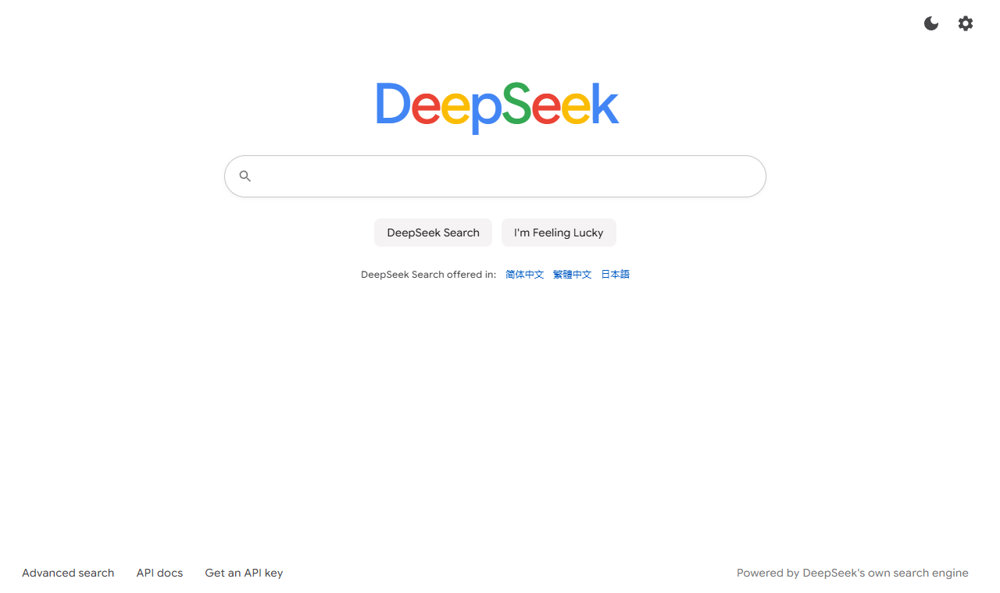
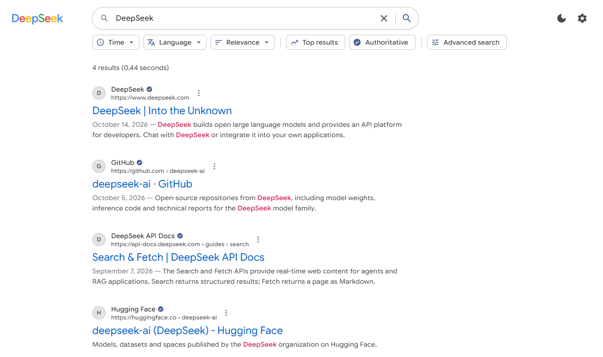

[简体中文](docs/README.zh-CN.md) | [繁體中文](docs/README.zh-TW.md) | English | [日本語](docs/README.ja-JP.md)

---

# DeepSeek Search

A web search engine built on the [DeepSeek Search / Fetch API](https://api-docs.deepseek.com/guides/search).

**Try it online:** https://reuac.github.io/redeepseek-search/

Open the page, click the gear icon in the top-right corner, and enter your own DeepSeek API key to start searching.

## Screenshots





The search results in the screenshots are sample data.

## Tech stack

| Category   | Technology                   |
| ---------- | ---------------------------- |
| UI         | React 19                     |
| Language   | TypeScript 6                 |
| Build tool | Vite 8                       |
| Styling    | CSS Modules                  |
| Code style | ESLint, Prettier             |
| Deployment | GitHub Actions, GitHub Pages |

## Run locally

```bash
npm install
npm run dev
npm run build
npm run lint
```

## Features

| Feature          | Description                                                                                                                                         |
| ---------------- | --------------------------------------------------------------------------------------------------------------------------------------------------- |
| Search operators | Supports `site:`, `-site:`, `"phrase"`, `-word`, `lang:`, `after:` and `before:`, or build them with the advanced search form                       |
| Filter and sort  | Time, language, top results, authoritative sources, and sorting by publish date                                                                     |
| Page content     | Fetch a page's text from the details panel; with `need_content` on, the text returned with the results is shown directly; URLs can be read directly |
| Search options   | Result count `count`, original question `ori_question`, localization IP `localization`                                                              |
| Reliability      | Automatic retries on 408 / 429 / 5xx; client-side rate limiting keeps each API under 5 QPS                                                          |
| Usage            | Counts search and fetch requests the way they are billed and estimates the cost                                                                     |
| Languages        | Simplified Chinese, Traditional Chinese, English and Japanese, detected from the browser language and switchable at any time                        |
| Other            | Search history, I'm Feeling Lucky, light and dark themes; identical requests are sent only once per session                                         |

## Privacy

This is a purely static site with no backend. Your API key, search history and usage data are stored only in your own browser, and requests go straight from the browser to `https://api.deepseek.com`. If you use a shared computer, clear your API key in settings when you are done.

## Project structure

```
src/
├── app/                 Root component
├── pages/               Home page, results page
├── features/            Search, settings, appearance, history, usage and other feature modules
├── components/  ui/     Shared components
├── i18n/                Translations and language detection
├── theme/               Theme and styles
├── router/              Routing
├── services/deepseek/   DeepSeek API client
└── lib/                 Utilities
```

## Deployment

Pushing to the `main` branch triggers GitHub Actions, which builds the site and publishes it to GitHub Pages. In development, requests go through the Vite local proxy; production builds connect to DeepSeek directly, and you can also enter your own proxy URL in settings.

## License

[MIT](./LICENSE)
