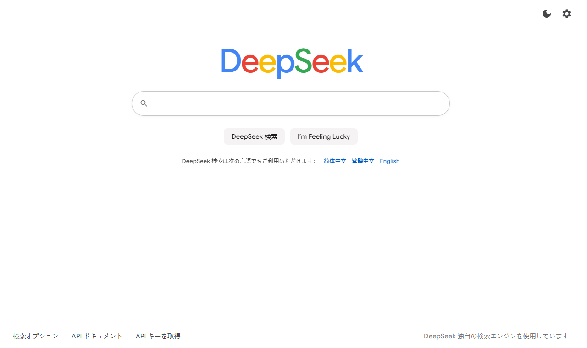
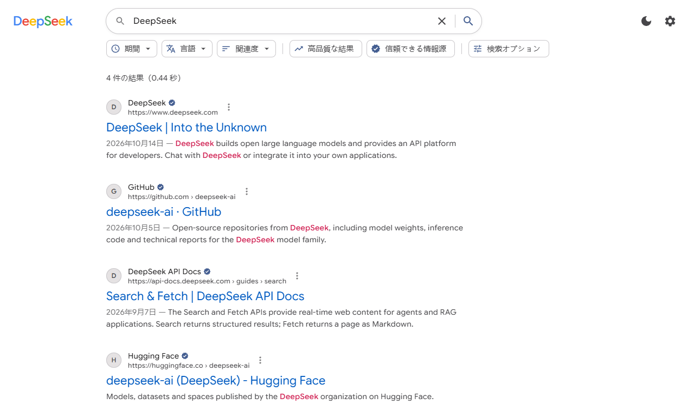

[简体中文](README.zh-CN.md) | [繁體中文](README.zh-TW.md) | [English](../README.md) | 日本語

---

# DeepSeek 検索

[DeepSeek Search / Fetch API](https://api-docs.deepseek.com/guides/search) を使ったウェブ検索エンジンです。

**オンラインで使う：** https://reuac.github.io/redeepseek-search/

ページを開いて右上の歯車アイコンをクリックし、ご自身の DeepSeek API キーを入力すると検索できます。

## スクリーンショット





スクリーンショットの検索結果はサンプルデータです。

## 技術スタック

| 分類              | 技術                         |
| ----------------- | ---------------------------- |
| UI フレームワーク | React 19                     |
| 開発言語          | TypeScript 6                 |
| ビルドツール      | Vite 8                       |
| スタイル          | CSS Modules                  |
| コード規約        | ESLint、Prettier             |
| デプロイ          | GitHub Actions、GitHub Pages |

## ローカルで実行

```bash
npm install
npm run dev
npm run build
npm run lint
```

## 機能

| 機能               | 説明                                                                                                                                       |
| ------------------ | ------------------------------------------------------------------------------------------------------------------------------------------ |
| 検索演算子         | `site:`、`-site:`、`"フレーズ"`、`-キーワード`、`lang:`、`after:`、`before:` に対応。検索オプションのフォームでも組み立てられます          |
| 絞り込みと並べ替え | 期間、言語、高品質な結果、信頼できる情報源、公開日順の並べ替え                                                                             |
| ページ本文         | 詳細パネルで Fetch により本文を取得。`need_content` を有効にすると検索結果と一緒に返された本文をそのまま表示。URL を直接読むこともできます |
| 検索オプション     | 返す件数 `count`、元の質問 `ori_question`、ローカライズ用 IP `localization`                                                                |
| 安定性             | 408 / 429 / 5xx は自動で再試行。クライアント側のレート制限で各 API を 5 QPS 以内に抑えます                                                 |
| 利用状況           | 課金基準に沿って検索と取得の回数を集計し、料金を推定します                                                                                 |
| 多言語             | 简体中文、繁體中文、English、日本語に対応。ブラウザの言語から自動で選択され、いつでも切り替えられます                                      |
| その他             | 検索履歴、I'm Feeling Lucky、ライト / ダークテーマ。同じリクエストは 1 セッション中に 1 回しか送信しません                                 |

## プライバシー

バックエンドを持たない静的サイトです。API キー、検索履歴、利用状況はお使いのブラウザにのみ保存され、リクエストはブラウザから `https://api.deepseek.com` へ直接送信されます。共用のパソコンで使った後は、設定から API キーを消去することをおすすめします。

## ディレクトリ構成

```
src/
├── app/                 ルートコンポーネント
├── pages/               トップページ、検索結果ページ
├── features/            検索、設定、表示、検索履歴、利用状況などの機能モジュール
├── components/  ui/     共通コンポーネント
├── i18n/                翻訳と言語の判定
├── theme/               テーマとスタイル
├── router/              ルーティング
├── services/deepseek/   DeepSeek API クライアント
└── lib/                 ユーティリティ
```

## デプロイ

`main` ブランチにプッシュすると GitHub Actions が自動でビルドし、GitHub Pages に公開します。開発環境では Vite のローカルプロキシ経由でリクエストを転送します。本番ビルドは DeepSeek に直接接続し、設定で独自のプロキシ URL を指定することもできます。

## ライセンス

[MIT](../LICENSE)
