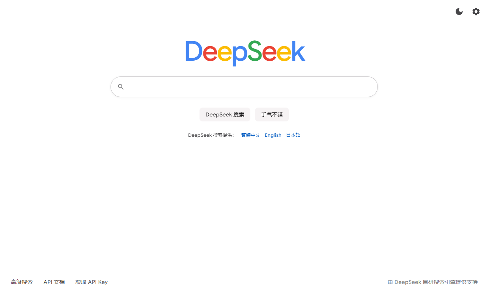
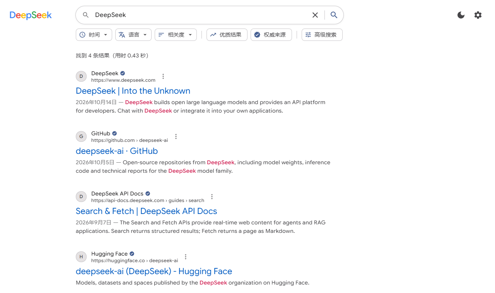

简体中文 | [繁體中文](README.zh-TW.md) | [English](../README.md) | [日本語](README.ja-JP.md)

---

# DeepSeek 搜索

基于 [DeepSeek Search / Fetch API](https://api-docs.deepseek.com/zh-cn/guides/search) 的网页搜索引擎。

**在线使用：** https://reuac.github.io/redeepseek-search/

打开页面后点右上角齿轮，填入自己的 DeepSeek API Key 即可搜索。

## 截图





截图中的搜索结果为示例数据。

## 技术栈

| 类别     | 技术                         |
| -------- | ---------------------------- |
| 界面框架 | React 19                     |
| 开发语言 | TypeScript 6                 |
| 构建工具 | Vite 8                       |
| 样式     | CSS Modules                  |
| 代码规范 | ESLint、Prettier             |
| 部署     | GitHub Actions、GitHub Pages |

## 本地运行

```bash
npm install
npm run dev
npm run build
npm run lint
```

## 功能

| 功能       | 说明                                                                                                        |
| ---------- | ----------------------------------------------------------------------------------------------------------- |
| 搜索语法   | 支持 `site:`、`-site:`、`"短语"`、`-词`、`lang:`、`after:`、`before:`，也可以用高级搜索表单组合             |
| 筛选与排序 | 时间、语言、优质结果、权威来源、按发布时间排序                                                              |
| 网页正文   | 详情面板中用 Fetch 抓取正文；开启 `need_content` 后直接显示随搜索返回的正文；搜索词是网址时可直接阅读该网页 |
| 搜索选项   | 返回条数 `count`、原始问题 `ori_question`、本地化 IP `localization`                                         |
| 稳定性     | 408 / 429 / 5xx 自动重试；客户端限流在每个接口 5 QPS 以内                                                   |
| 用量       | 按计费口径统计搜索和抓取次数，并估算费用                                                                    |
| 多语言     | 简体中文、繁體中文、English、日本語，根据浏览器语言自动选择，也可以随时切换                                 |
| 其它       | 搜索历史、手气不错、浅色 / 深色主题；相同请求在同一会话内只发一次                                           |

## 隐私

纯静态网页，没有后端。API Key、搜索历史和用量统计只保存在你自己的浏览器里，请求直接从浏览器发往 `https://api.deepseek.com`。在公共电脑上用完后，建议在设置中清空 API Key。

## 目录结构

```
src/
├── app/                 根组件
├── pages/               首页、结果页
├── features/            搜索、设置、外观、历史记录、用量等功能模块
├── components/  ui/     通用组件
├── i18n/                多语言文案与语言识别
├── theme/               主题与样式
├── router/              路由
├── services/deepseek/   DeepSeek API 客户端
└── lib/                 工具函数
```

## 部署

推送到 `main` 分支后，GitHub Actions 会自动构建并发布到 GitHub Pages。开发环境通过 Vite 本地代理转发请求；生产构建默认直连 DeepSeek，设置中也可以填写自建的代理地址。

## 许可证

[MIT](../LICENSE)
