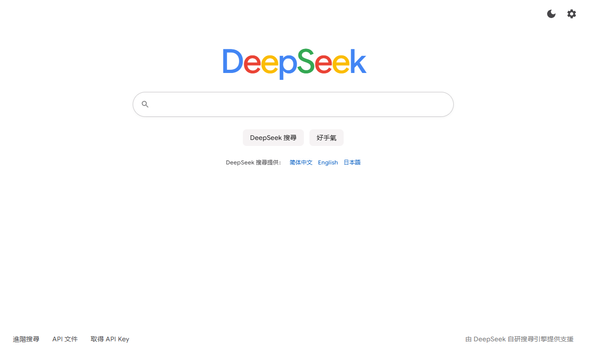
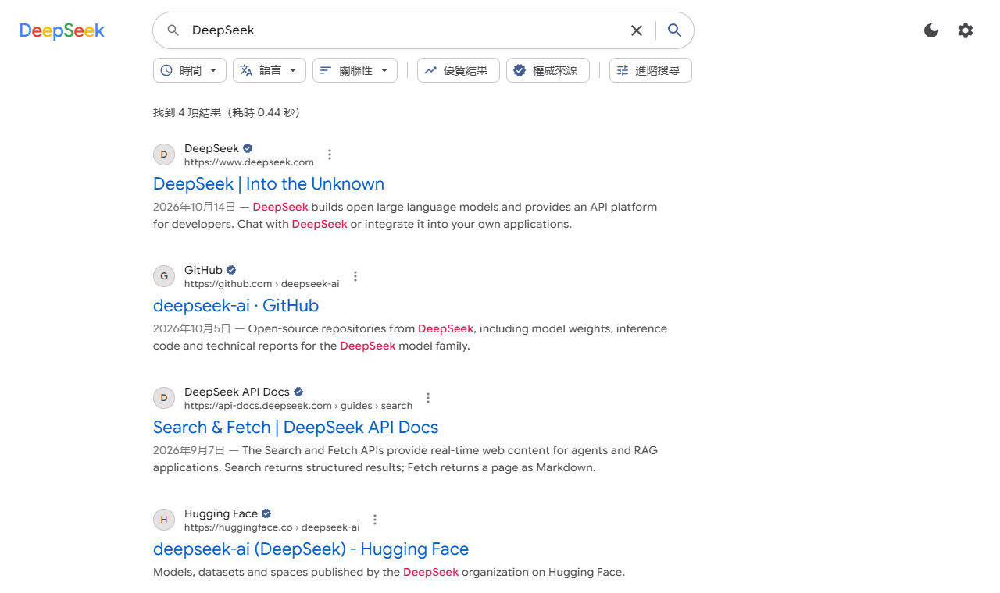

[简体中文](README.zh-CN.md) | 繁體中文 | [English](../README.md) | [日本語](README.ja-JP.md)

---

# DeepSeek 搜尋

基於 [DeepSeek Search / Fetch API](https://api-docs.deepseek.com/zh-cn/guides/search) 的網頁搜尋引擎。

**線上使用：** https://reuac.github.io/redeepseek-search/

開啟頁面後點右上角的齒輪，填入自己的 DeepSeek API Key 即可開始搜尋。

## 螢幕截圖





截圖中的搜尋結果為範例資料。

## 技術架構

| 類別       | 技術                         |
| ---------- | ---------------------------- |
| 介面框架   | React 19                     |
| 開發語言   | TypeScript 6                 |
| 建置工具   | Vite 8                       |
| 樣式       | CSS Modules                  |
| 程式碼規範 | ESLint、Prettier             |
| 部署       | GitHub Actions、GitHub Pages |

## 在本機執行

```bash
npm install
npm run dev
npm run build
npm run lint
```

## 功能

| 功能       | 說明                                                                                                          |
| ---------- | ------------------------------------------------------------------------------------------------------------- |
| 搜尋語法   | 支援 `site:`、`-site:`、`"詞組"`、`-字詞`、`lang:`、`after:`、`before:`，也可以用進階搜尋表單組合             |
| 篩選與排序 | 時間、語言、優質結果、權威來源、依發布時間排序                                                                |
| 網頁內文   | 在詳細資訊面板中用 Fetch 擷取內文；開啟 `need_content` 後直接顯示隨搜尋傳回的內文；搜尋字詞是網址時可直接閱讀 |
| 搜尋選項   | 傳回結果數 `count`、原始問題 `ori_question`、在地化 IP `localization`                                         |
| 穩定性     | 408 / 429 / 5xx 自動重試；用戶端限流讓每個介面維持在 5 QPS 以內                                               |
| 用量       | 依計費方式統計搜尋與擷取次數，並預估費用                                                                      |
| 多語言     | 简体中文、繁體中文、English、日本語，依瀏覽器語言自動選擇，也可以隨時切換                                     |
| 其他       | 搜尋記錄、好手氣、淺色 / 深色主題；相同請求在同一工作階段內只送出一次                                         |

## 隱私

純靜態網頁，沒有後端。API Key、搜尋記錄和用量統計只會儲存在你自己的瀏覽器中，請求直接從瀏覽器送往 `https://api.deepseek.com`。在公用電腦上使用完畢後，建議在設定中清除 API Key。

## 目錄結構

```
src/
├── app/                 根元件
├── pages/               首頁、結果頁
├── features/            搜尋、設定、外觀、搜尋記錄、用量等功能模組
├── components/  ui/     共用元件
├── i18n/                多語言文案與語言偵測
├── theme/               主題與樣式
├── router/              路由
├── services/deepseek/   DeepSeek API 用戶端
└── lib/                 工具函式
```

## 部署

推送到 `main` 分支後，GitHub Actions 會自動建置並發布到 GitHub Pages。開發環境透過 Vite 本機代理轉送請求；正式版建置預設直接連線 DeepSeek，也可以在設定中填寫自架的代理位址。

## 授權條款

[MIT](../LICENSE)
